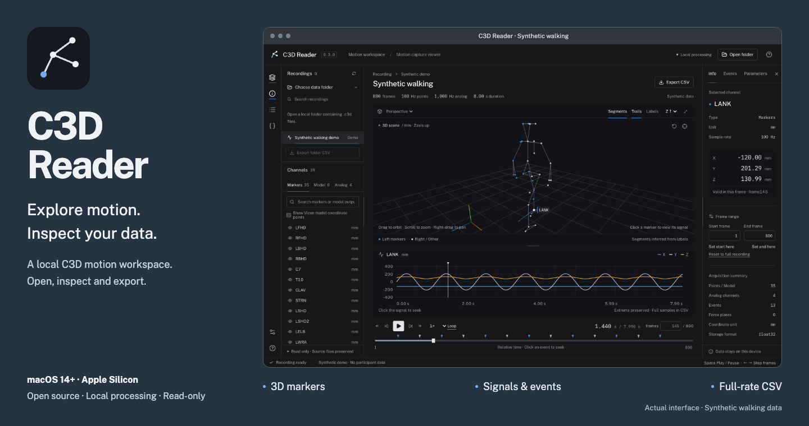
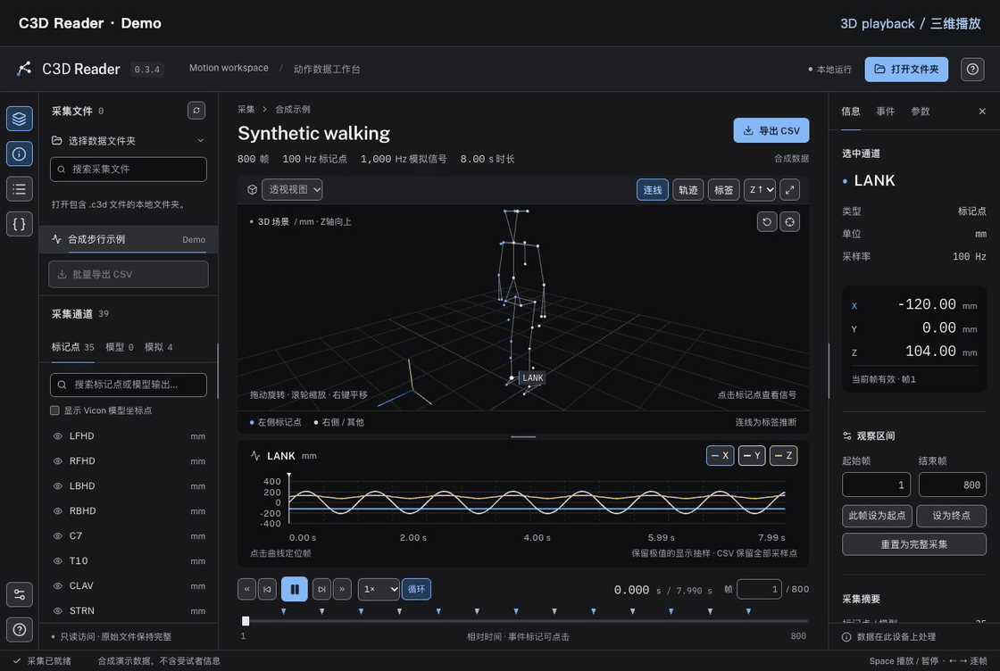
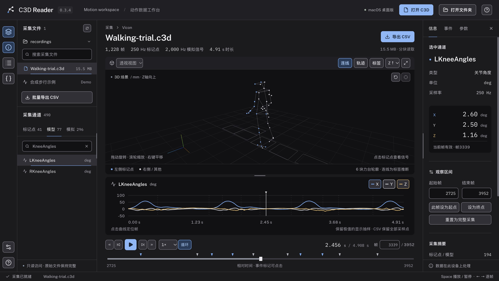

# C3D Reader

[简体中文](README.md) | [English](README.en.md)



A local C3D motion capture viewer inspired by [Mokka](https://biomechanical-toolkit.github.io/mokka/), built for inspecting Vicon recordings, gait acquisitions and biomechanics data. Open acquisitions, inspect 3D markers and synchronized signals, navigate gait events, and export full-resolution CSV data. A macOS desktop app and a local browser version are available. The interface supports Simplified Chinese and English.

[Download for macOS](https://github.com/SourorangeChen/C3D_Reader/releases/latest) · [Getting started](#getting-started) · [Development](#development-and-testing)

## Demo

Recorded from the real interface using the built-in synthetic walking acquisition: 3D playback → views and marker trails → analog signals → gait event navigation → CSV export → theme / language settings → panel resizing.



[Watch the clearer MP4 version](https://github.com/SourorangeChen/C3D_Reader/raw/refs/heads/main/docs/media/demo.mp4). The demo uses the browser version; the desktop app shares the same data workbench. No participant recordings are included.

## Features

- 3D marker playback, orbit, pan, zoom, front / side / top views, and Z-up / Y-up switching.
- Marker selection, visibility, labels, and trails showing the selected marker's previous 1.5 seconds.
- Connections inferred from common Plug-in Gait labels; optional hiding of Vicon model coordinate points.
- XYZ plots, model outputs such as joint angles / forces / moments / powers, and analog signals including EMG / IMU channels.
- Synchronized timeline, original frame numbers, 0.1×–2× playback, looping, event navigation and observation intervals.
- C3D parameter inspector with groups, dimensions and raw values; force platform outlines in the 3D view.
- CSV export of the current channel and observation interval, preserving full sampling rates and physical units.
- Folder-wide CSV export of all point / model and analog channels at full resolution, with progress, cancellation and a failure manifest.
- Settings for dark / light / system themes and Chinese / English, saved automatically.
- A larger default 3D area and draggable dividers for both side panels and the 3D / signal split, with remembered sizes.
- Vicon split label, unit, scale and offset parameters for acquisitions with more than 255 channels.
- Memory-mapped reading and 500-frame transfer blocks for acquisitions of several hundred MB.
- A reproducible synthetic walking demo, so no experimental recording is needed to try the app.

## Getting started

### macOS desktop app (recommended)

Download `C3D-Reader-0.3.0-macOS-arm64.dmg` from [Releases](https://github.com/SourorangeChen/C3D_Reader/releases). Double-click the disk image, drag **C3D Reader.app** onto the **Applications** shortcut, then launch it from Applications. Eject the disk image after installation. A ZIP archive is also available. The current build requires **Apple Silicon (M1 / M2 / M3 / M4 and later) and macOS 14+**. An Intel Mac build is not available.

The desktop app bundles Python, the reading engine, Chromium and frontend assets. You do not need to install Python or Node.js, connect to the internet, or start a web service yourself.

- Drop a `.c3d` file into the app window to open it. Recordings are read in place, without uploading or copying them.
- Click **打开 C3D (Open C3D)** or press **⌘O** to select a file with the native macOS dialog.
- Open files through Finder's **Open With**, drop them onto the Dock icon, or open a recording before the app is running. If the app is not listed yet, choose **Open With → Other…** and select C3D Reader.
- Click **打开文件夹 (Open folder)** or press **⌘⇧O** to browse a directory of recordings.
- Click **Settings** at the bottom left or press **⌘,** to choose the theme and interface language.
- Drag the right edge of the file panel, the left edge of the inspector, or the divider between 3D and signals. Double-click a divider to reset it. Focus a divider and use arrow keys to resize or Enter to reset; Settings can reset the entire layout.
- Click **Export folder CSV → Start export**, then download the ZIP. Closing the progress window keeps the job running; reopen it to check progress.
- Quitting the app or closing its last window automatically stops the local reading service.

The current build is **ad-hoc signed; it has not been Apple Developer ID signed or notarized**. Locally built copies can run directly, but Gatekeeper may block a copy downloaded onto another Mac. If you trust the project, confirm it using **Open Anyway** in macOS **Privacy & Security**. Do not disable system security checks.



### Run the browser version from source

Requires **Python 3.9+** and **Node.js 22.12+ or 24+** for the initial frontend build. Installing dependencies requires an internet connection. Once built, fonts, the interface and data processing run locally without a CDN.

```sh
git clone https://github.com/SourorangeChen/C3D_Reader.git
cd C3D_Reader
python3 run.py
```

The launcher creates a project-local `.venv`, installs Python dependencies, builds the frontend, and opens [http://127.0.0.1:8000](http://127.0.0.1:8000). Click **打开文件夹 (Open folder)** and paste the path to a folder containing `.c3d` files. On macOS, select a folder in Finder and press **⌥⌘C** to copy its path.

From a source checkout on macOS, you can also double-click `Start C3D Reader.command`. On Windows, run `start.bat` after installing Python and Node.js.

Additional launcher options:

```sh
python3 run.py --data "/path/to/Vicon"
python3 run.py --port 8001 --no-browser
python3 run.py --rebuild
```

Press **Ctrl+C** in the terminal running the program to stop the service. It listens only on `127.0.0.1` by default. Keep external drives connected while reading their recordings.

## Controls

| Action | Method |
| --- | --- |
| Orbit / pan / zoom | Left drag / right drag / scroll wheel |
| Select a channel | Use the marker, model or analog tabs on the left, or click a 3D marker |
| Play / pause | Space |
| Step frames | ← / →; hold Shift to jump 10 frames |
| Jump to interval boundaries | Home / End |
| Seek to a sample | Click a plot or event marker, or enter an original frame number |
| Export an interval | Set the first and last frames in the information panel, then click **导出 CSV (Export CSV)** |

### Batch CSV structure

The export includes every `.c3d` / `.C3D` file in the current directory, regardless of file search, selected channel or frame range. It does not recurse into subfolders. Each successful recording has its own numbered directory in the ZIP:

- `points.csv`: X / Y / Z / residual for all markers and model outputs, with original frame numbers and relative times.
- `analog.csv`: every sample of all analog channels; omitted for recordings without analog channels.
- Root-level `manifest.json`: source filenames, frame ranges, channel units, sample rates and failed files. Invalid or unreadable recordings do not stop other files.

One batch runs at a time. Temporary CSVs and ZIPs stay in the local temporary directory. Completed ZIPs are removed after 30 minutes without a download, when starting another batch, or at app shutdown. Packaging requires available temporary disk space. Exported filenames and channel labels retain source data; exporting does not anonymize recordings.

## Data conventions and scope

- **Time is relative to the first frame, starting at 0 seconds.** Frame numbers retain the source numbering. Events are converted from C3D acquisition time to original frame numbers. Interval boundaries are inclusive in both the interface and CSV exports.
- Point coordinates retain the units declared in the file. Only the 3D renderer converts `mm` / `cm` / `m` to scene meters. Model outputs use their respective `ANGLE_UNITS`, `FORCE_UNITS` and related parameters.
- Analog values use `(raw − OFFSET) × SCALE × GEN_SCALE`. This conversion also applies to floating-point files.
- Missing markers are omitted from the 3D view and break plot lines. CSV coordinates are blank and the residual is −1.
- Plots use extrema-preserving display downsampling and each displayed sample's actual timestamp. CSV exports retain every sample. Plot hover information uses the nearest displayed sample.
- Marker connections are visual aids based on common labels, not a fitted skeletal model. Force platforms currently show their outlines; raw force and moment channels can be inspected in analog plots. **COP / GRF calculations are not implemented.**
- Supports floating-point and integer storage in Intel / IEEE little endian and MIPS big endian formats. DEC / VAX files produce an explicit unsupported-format error. Local experimental validation covers Intel floating-point files; synthetic regression tests cover integer files. MIPS has not yet been validated against real recordings.
- C3D editing or write-back, VSK / VST model import, video synchronization, acquisition merging, signal processing and clinical interpretation are not included. The goal is an extensible reading and inspection tool; it is not yet a complete replacement for Mokka.

## Privacy

There are no recording uploads, telemetry or remote analytics. The browser version stores its folder in `~/.config/c3d-reader/settings.json` and interface preferences in browser local storage. Desktop folder settings, interface preferences (`preferences.json`) and startup logs are stored in `~/Library/Application Support/c3d-reader/`; macOS manages recent-file history. Set `C3D_READER_CONFIG_DIR` to change the settings directory. Experimental recordings are not copied into the repository. The default `.gitignore` excludes C3D recordings, Vicon calibration / model files, CSV exports, configuration, build artifacts and local test outputs.

Published validation statistics and demo media use synthetic data generated by `backend/demo.py`. Before signing, desktop builds remove dependency installation records and local-origin metadata, then inspect files, compressed contents and frozen Python modules for the builder's source/home paths, common credential formats and non-distributable files. This gate does not replace manual privacy review. Updating the current documentation does not erase validation statistics in earlier Git commits.

Use the local service only on your own trusted device. It has no multi-user authentication and is not intended for public internet deployment.

## Development and testing

```sh
python3 -m venv .venv
source .venv/bin/activate           # Windows: .venv\Scripts\activate
pip install -r requirements-dev.txt
npm ci
python -m pytest -q
npm run build
npx playwright install chromium
npm test
```

For development, run the backend and frontend in separate terminals:

```sh
python -m uvicorn backend.app:app --host 127.0.0.1 --port 8000
npm run dev
```

Open the local address printed by Vite. Vite proxies `/api` to the Python service. Browser tests use isolated settings and port 8011, without reading personal folder settings.

Project structure: `backend/acquisition.py` handles C3D data and scaling, while `backend/app.py` exposes the local API. `frontend/src/Viewer.tsx` implements the Three.js scene, `SignalPlot.tsx` draws signals, and `App.tsx` coordinates selection, playback and intervals. See [Architecture and validation](docs/architecture.md) and [References and attribution](docs/references.md).

### Build the desktop app

Build on an Apple Silicon Mac with Python, Node.js and Xcode Command Line Tools installed:

```sh
python3 -m venv .venv
.venv/bin/pip install -r requirements-desktop.txt -r requirements-dev.txt
npm ci
npm run desktop:build
npm run test:desktop
C3D_TEST_APP="$PWD/release/mac-arm64/C3D Reader.app/Contents/MacOS/C3D Reader" npm run test:desktop
```

The app is written to `release/mac-arm64/C3D Reader.app`. The DMG, ZIP and SHA-256 checksums are also in `release/`. The frontend obtains native file paths through Electron's isolated preload, and PyInstaller packages the Python engine. The desktop-only file-opening endpoint uses a private token generated for each launch, and the service binds a random loopback port. See [Desktop implementation and verification](docs/desktop.md) for build boundaries and test results.

## License

[MIT](LICENSE). Independent implementation; not affiliated with the Mokka or Biomechanical ToolKit projects.
