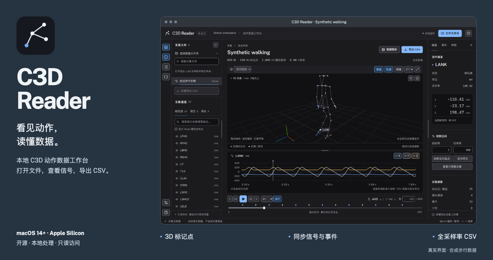

# C3D Reader

[简体中文](README.md) | [English](README.en.md)



一款受 [Mokka](https://biomechanical-toolkit.github.io/mokka/) 启发、本地运行的 C3D 动作数据读取工具，面向 Vicon 运动捕捉、步态分析与生物力学数据检查。支持简体中文和英文界面，提供 macOS 桌面应用和本地浏览器两种运行方式，数据直接从本机磁盘读取。

[下载 macOS 安装包](https://github.com/SourorangeChen/C3D_Reader/releases/latest) · [安装与运行](#运行) · [开发与测试](#开发与测试)

## 演示

真实界面录制，全部使用程序生成的合成步行示例：三维播放 → 视角与轨迹 → 合成力与肌电信号 → 步态事件定位 → CSV 导出 → 主题与语言设置 → 调整面板。

示例由 `backend/demo.py` 生成，共 800 帧，标记点为 100 Hz，四个模拟通道为 1000 Hz。动作、力、肌电、质心与事件均为演示数据，不来自受试者采集。三维连线是标记点标签推断的观察辅助。


[观看清晰版 MP4](https://github.com/SourorangeChen/C3D_Reader/raw/refs/heads/main/docs/media/demo.mp4)。演示录制自浏览器版，桌面版使用相同的数据工作台。当前展示素材仅包含合成示例，不含真实受试者动作、波形、原始视频或采集文件。

## 功能

- 3D 标记点播放、旋转、平移、缩放、正面 / 侧面 / 俯视方向、Z / Y 向上切换。
- 标记点选择、可见性、标签、最近 1.5 秒的选中点轨迹。
- 按常用 Plug-in Gait 标签推断连线；可隐藏 Vicon 模型坐标点。
- XYZ 曲线、关节角度 / 力 / 力矩 / 功率等模型输出、EMG / IMU 等模拟信号。
- 同步时间轴、原始帧号、0.1×–2× 播放、循环、事件跳帧、观察区间。
- 本机视频及按帧编号图片序列与 Vicon 并排同步播放，macOS 桌面版可在导入后自动识别动作并对齐，另支持手动定点、COM 对齐 JSON、时间戳基线及已有视频信号的相关搜索。
- C3D 参数检查器，显示参数组、维度与原始值；显示力台几何轮廓。
- CSV 默认一次导出当前文件全部点位（含模型输出及已有 COM），也可单独导出 COM / 地面投影、当前通道或全部模拟通道；可选完整采集或观察区间。
- 整个目录批量导出 CSV：全部点位 / 模型及模拟通道，保留全采样率，支持进度、取消及失败清单。
- 设置窗口：深色 / 浅色 / 跟随系统主题，中英文切换，自动保存。
- 更大的默认 3D 区域；左右面板和 3D / 曲线之间支持拖动调整大小，布局自动记忆。
- 支持 Vicon 超过 255 个通道的分段标签、单位、缩放及偏移参数。
- 内存映射和 500 帧传输块，适合数百 MB 的采集文件。
- 内置可复现的合成步行示例，不需要实验数据即可运行。

## 运行

### macOS 桌面应用（推荐）

在 [Releases](https://github.com/SourorangeChen/C3D_Reader/releases) 下载 `C3D-Reader-0.3.4-macOS-arm64.dmg`，双击打开，将 **C3D Reader.app** 拖到旁边的 **Applications（应用程序）** 文件夹，然后从“应用程序”双击启动。安装后可推出磁盘镜像。也提供 ZIP 解压版本。当前构建适用于 **Apple Silicon（M1 / M2 / M3 / M4 等）和 macOS 14+**，Intel Mac 尚未提供安装包。

桌面版已经包含 Python、读取引擎、Chromium 和前端资源，使用时无需安装 Python / Node.js，也无需联网或先启动网页服务。

- 将一个 `.c3d` 文件直接拖进应用窗口打开；文件不会被上传或复制。
- 点击「打开 C3D」或按 **⌘O**，使用 macOS 原生文件窗口选择文件。
- 支持 Finder 的“打开方式”、拖到 Dock 图标、以及应用未启动时打开 C3D 文件。安装后如系统尚未选择它，可用“打开方式 → 其他…”选择 C3D Reader。
- 点击「打开文件夹」或按 **⌘⇧O** 批量浏览目录。
- 点击左下角「设置」，或按 **⌘,**，选择主题和界面语言。
- 拖动文件面板右侧、信息面板左侧及 3D / 曲线之间的分隔条调整大小；双击分隔条恢复该项默认值。也可聚焦分隔条，用方向键调整，Enter 恢复默认；设置中可恢复整个布局。
- 在文件列表下方点击「批量导出 CSV」→「开始导出」，完成后下载 ZIP。显示点位 / 模拟通道的逐块帧进度、ZIP 压缩进度和用时；大文件也会持续更新。关闭窗口或刷新界面后再次打开，可连接回原任务。
- 退出或关闭最后一个窗口时，本地读取服务会自动结束。

当前构建使用 **ad-hoc 签名，尚未通过 Apple Developer ID 签名和公证**。本机构建可直接运行；从互联网下载到另一台 Mac 后可能被 Gatekeeper 阻止。仅在信任本项目的情况下，通过 macOS“隐私与安全性”中的“仍要打开”完成系统确认。不要关闭系统安全检查。


### 从源码运行浏览器版

需要 **Python 3.9+**，首次构建还需 **Node.js 22.12+ 或 24+**。初次安装依赖需要联网，构建后字体、界面和数据处理均在本机运行，无需 CDN。

```sh
git clone https://github.com/SourorangeChen/C3D_Reader.git
cd C3D_Reader
python3 run.py
```

启动器会创建项目内的 `.venv`、安装 Python 依赖、构建前端并打开 [http://127.0.0.1:8000](http://127.0.0.1:8000)。在界面点击「打开文件夹」，粘贴包含 `.c3d` 文件的文件夹路径。macOS 可在 Finder 选中文件夹，按 **⌥⌘C** 复制路径。

源码版 macOS 也可双击 `Start C3D Reader.command`；Windows 可运行 `start.bat`（须已安装 Python 和 Node.js）。

也可以指定文件夹：

```sh
python3 run.py --data "/path/to/Vicon"
python3 run.py --port 8001 --no-browser
python3 run.py --rebuild
```

在运行程序的终端按 **Ctrl+C** 停止服务。默认只监听 `127.0.0.1`。外置硬盘须保持连接。

## 操作

| 操作               | 方法                                             |
| ------------------ | ------------------------------------------------ |
| 旋转 / 平移 / 缩放 | 左键拖动 / 右键拖动 / 滚轮                       |
| 选择通道           | 左侧标记点、模型、模拟标签页；也可点击 3D 标记点 |
| 播放 / 暂停        | Space                                            |
| 前后逐帧           | ← / →；配合 Shift 跳 10 帧                       |
| 跳到观察区间两端   | Home / End                                       |
| 定位采样           | 点击曲线、事件标记或填写原始帧号                 |
| 导出当前文件       | 点击「导出 CSV」，默认全部点位、完整采集；可切换 COM、当前通道、模拟通道和观察区间 |

### 视频与图片序列同步（0.4.0 起）

1. 打开 C3D，点击主工作区右上方「视频同步」，导入一个视频，或同一录制的多张编号图片；也可直接拖入。视频支持浏览器可解码的 MP4 / MOV / WebM 等格式，图片支持 JPG / PNG / WebP / BMP。
2. 图片文件名应以帧号结尾，例如 `frame_000123.jpg`。填写这次录制的 FPS，并选择帧号从 0 还是 1 开始；变帧率素材可导入 `frame,video_pts_s` CSV，表中 frame 始终为原视频零基帧号。缺失图片保留为空档，不会重新编号。
3. **0.4.1 macOS 桌面版会自动识别素材中的人体动作，与当前 Vicon 观察区间匹配，并应用可靠的时间偏移**；图片需先填写 FPS 或 PTS。进度显示在「自动动作对齐」中；不可靠或重复动作会提示核查，不能确定时不会默认从零对齐。可调整观察区间或人物位置后「重新识别」，也可用「将当前画面对齐到此 C3D 帧」手动定点。随后使用原有时间轴播放、慢放、循环和逐帧。
4. 「时间对齐」还可填写基线和偏移、计算带时区的拍摄时间基线、导入 COM 对齐结果，或从已有视频信号 CSV 估计偏移。COM 采用 `overall_lag_s` 与所选试次的 `timestamp_only_start_s`；未提供共享偏移时，仅对 `accepted` 试次取修正中位数。
5. 「保存当前对齐」下载 JSON，记录 C3D、素材信息、时间对应和信号搜索依据。再次导入前选择相同素材；图片需使用相同的 FPS / PTS 设置。重新打开或切换 C3D 后需重新选择素材。

时间约定为 `视频 PTS = 时间戳基线 + 统一偏移 + C3D 相对时间`，正偏移选择更晚的画面。视频用实际呈现时间驱动 Vicon，不假设固定 FPS。自动匹配使用本机 Apple Vision 姿态和 COM 的关节投影匹配思路，用于辅助同步播放，不替代 COM/PCT 的正式验证。支持具备肩、髋、膝、踝对应通道的 2–60 秒观察区间；遮挡、重复动作和多人可能无法可靠对齐，结果需目视复核。不校正时钟漂移。浏览器版仍可使用手动定点、COM JSON 和 CSV 搜索。素材仅在本机读取。算法与数据格式详见 [同步说明](docs/media-sync.md)。自动动作对齐从本地构建的 0.4.1 macOS 安装包开始提供。0.4.0 仅包含手动、COM JSON 和 CSV 方法；此前公开的 0.3.4 不包含视频同步。

### 当前文件的全部点位与 COM 导出

点击主工作区的「导出 CSV」，默认导出**全部点位、完整采集**，无需逐个选择关键点。每帧一行，所有点位按列展开，包含 X / Y / Z / residual、原始标签、单位、帧号和相对时间；通道搜索、隐藏状态与曲线抽样不影响导出。

「导出内容」还可选择「仅 COM 及地面投影」「当前选中通道」或「全部模拟通道」；「导出区间」可改为当前观察区间。

COM 从源 C3D 原样读取，识别 `CentreOfMass`、`CenterOfMass`、`COM` 及对应 `Floor` 名称，支持主体前缀、大小写、空格和下划线。三维质心与地面投影分别保留；投影含义可参考 [Vicon Plug-in Gait 参考指南](https://help.vicon.com/download/attachments/406490967/Plug-in%20Gait%20Reference%20Guide.pdf)。软件不重新计算质心，也不会把标记点平均位置当成质心。未识别到 COM 时会明确提示；自定义名称的通道仍包含在「全部点位」中。

### 批量 CSV 文件结构

导出当前目录中的全部 `.c3d` / `.C3D` 文件，不受文件搜索、当前通道或观察区间影响，不递归子目录。ZIP 内每个成功采集有独立编号目录：

- `points.csv`：全部标记点和模型输出的 X / Y / Z / residual，带原始帧号及相对时间。
- `analog.csv`：全部模拟通道，保留每个模拟采样点；没有模拟通道的采集不生成此文件。
- ZIP 根目录的 `manifest.json`：文件名、帧范围、通道单位、采样率和失败项。损坏或不可读的文件不阻止其他文件导出。

同时只运行一个批次。临时 CSV 和 ZIP 位于本机临时目录；完成的 ZIP 在 30 分钟无下载后、启动新批次或退出时清理。ZIP 生成阶段需要可用临时磁盘空间。导出的文件名和通道名称沿用源数据，导出不会自动匿名化数据。

## 数据约定与范围

- **首帧相对时间为 0 秒**，帧号保留源文件编号。事件按照 C3D 的采集时间转换为原始帧号。起止帧在界面和 CSV 中均包含两端。
- 点坐标保持文件声明的单位。只在 3D 绘制时将 `mm` / `cm` / `m` 换算为场景米制。模型输出使用各自的 `ANGLE_UNITS`、`FORCE_UNITS` 等参数。
- 模拟信号使用 `(raw − OFFSET) × SCALE × GEN_SCALE` 转换；浮点文件也应用此转换。
- 缺失标记点不绘制、不连接曲线；CSV 中坐标留空、residual 为 −1。
- 曲线为保持极值的显示抽样，横坐标使用每个点的实际时间，CSV 保留所有采样点。曲线悬浮信息取最近的显示采样点，分别标明游标时间和各曲线实际采样时间；缺失采样保留为空值。
- 连线仅是常见标签间的观察辅助，不代表拟合的骨骼模型。力台目前显示轮廓；原始力、力矩可查看模拟曲线，**尚未实现 COP / GRF 解算**。
- 支持 Intel / IEEE little endian 和 MIPS big endian 的浮点、整数存储；DEC / VAX 文件会给出明确错误。当前本地实验数据验证覆盖 Intel 浮点；整数格式由合成数据回归测试覆盖，MIPS 尚无真实文件回归验证。
- 当前不包含 C3D 编辑写回、VSK / VST 模型导入、多采集合并、通用信号处理或临床判读。目标是一个可扩展的读取与检查工具，尚非 Mokka 的完整替代品。

## 隐私

没有数据上传、遥测或远端分析。浏览器版的目录设置保存在 `~/.config/c3d-reader/settings.json`，界面偏好保存在浏览器本地存储；桌面版的目录设置、`preferences.json` 界面偏好和启动日志保存在 `~/Library/Application Support/c3d-reader/`，最近打开记录由 macOS 管理。可用 `C3D_READER_CONFIG_DIR` 改变设置目录。实验文件不会复制到仓库。`.gitignore` 默认排除 C3D、Vicon 校准 / 模型文件、CSV 导出、配置、构建包及本地测试输出。

公开验证统计和应用内置示例使用 `backend/demo.py` 生成的合成数据。README 的截图、GIF 和 MP4 全部使用合成示例；生成脚本拒绝外部采集素材，真实采集与校准文件不分发。桌面构建在签名前移除依赖的安装记录和本地来源元数据，并检查文件、压缩内容和冻结 Python 模块中的构建机路径、常见凭据格式及不应分发的文件。此检查不能替代人工隐私审查。旧 Git 提交中的历史展示素材和验证统计不会因更新当前文件而自动消失。

请只将本地服务用于你自己的可信设备。程序没有多用户认证，不用于公开互联网部署。

## 开发与测试

```sh
python3 -m venv .venv
source .venv/bin/activate           # Windows: .venv\Scripts\activate
pip install -r requirements-dev.txt
npm ci
python -m pytest -q
npm run build
npx playwright install chromium
npm test
```

开发时在两个终端分别启动：

```sh
python -m uvicorn backend.app:app --host 127.0.0.1 --port 8000
npm run dev
```

打开 Vite 显示的本机地址。Vite 将 `/api` 代理到 Python 服务。浏览器测试使用隔离配置和端口 8011，不读取个人文件夹设置。

项目结构：`backend/acquisition.py` 负责 C3D 数据和缩放，`backend/app.py` 提供本地 API；`frontend/src/Viewer.tsx` 负责 Three.js 场景，`SignalPlot.tsx` 负责信号曲线，`App.tsx` 协调选择、播放和区间。详见 [架构与验证](docs/architecture.md) 及 [参考与归属](docs/references.md)。

### 构建桌面应用

在 Apple Silicon Mac 上运行，需 Python、Node.js 和 Xcode Command Line Tools：

```sh
python3 -m venv .venv
.venv/bin/pip install -r requirements-desktop.txt -r requirements-dev.txt
npm ci
npm run desktop:build
npm run test:desktop
C3D_TEST_APP="$PWD/release/mac-arm64/C3D Reader.app/Contents/MacOS/C3D Reader" npm run test:desktop
```

输出目录为 `release/mac-arm64/C3D Reader.app`，DMG、ZIP 和 SHA-256 校验值也位于 `release/`。前端通过 Electron 的隔离 preload 获取原生文件路径，Python 引擎由 PyInstaller 打包；桌面专用打开接口使用每次启动生成的私密令牌，服务绑定随机本机端口。[桌面实现与验证](docs/desktop.md) 记录了构建边界和测试结果。

## 许可证

[MIT](LICENSE)。本项目为独立实现，与 Mokka 或 Biomechanical ToolKit 项目无隶属关系。
