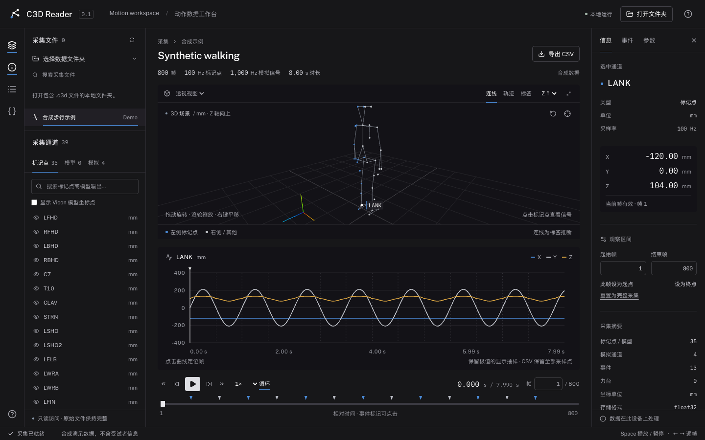

# C3D Reader

A local motion capture workspace inspired by [Mokka](https://biomechanical-toolkit.github.io/mokka/). Open C3D acquisitions, inspect 3D markers and synchronized signals, navigate gait events, and export full-resolution CSV data.

一款本地运行的 C3D 动作数据读取工具，面向 Vicon 运动捕捉、步态分析与生物力学数据检查。界面为简体中文。程序通过本机浏览器显示，数据直接从本机磁盘读取。



## 功能

- 3D 标记点播放、旋转、平移、缩放、正面 / 侧面 / 俯视方向、Z / Y 向上切换。
- 标记点选择、可见性、标签、最近 1.5 秒的选中点轨迹。
- 按常用 Plug-in Gait 标签推断连线；可隐藏 Vicon 模型坐标点。
- XYZ 曲线、关节角度 / 力 / 力矩 / 功率等模型输出、EMG / IMU 等模拟信号。
- 同步时间轴、原始帧号、0.1×–2× 播放、循环、事件跳帧、观察区间。
- C3D 参数检查器，显示参数组、维度与原始值；显示力台几何轮廓。
- 当前通道及观察区间的 CSV 导出，保留完整采样率和物理单位。
- 支持 Vicon 超过 255 个通道的分段标签、单位、缩放及偏移参数。
- 内存映射和 500 帧传输块，适合数百 MB 的采集文件。
- 内置可复现的合成步行示例，不需要实验数据即可运行。

## 运行

需要 **Python 3.9+**，首次构建还需 **Node.js 22.12+ 或 24+**。初次安装依赖需要联网，构建后字体、界面和数据处理均在本机运行，无需 CDN。

```sh
git clone https://github.com/SourorangeChen/C3D_Reader.git
cd C3D_Reader
python3 run.py
```

启动器会创建项目内的 `.venv`、安装 Python 依赖、构建前端并打开 [http://127.0.0.1:8000](http://127.0.0.1:8000)。在界面点击「打开文件夹」，粘贴包含 `.c3d` 文件的文件夹路径。macOS 可在 Finder 选中文件夹，按 **⌥⌘C** 复制路径。

macOS 也可双击 `Start C3D Reader.command`；Windows 可运行 `start.bat`（须已安装 Python 和 Node.js）。这些启动脚本不等同于经过签名的原生安装包。

也可以指定文件夹：

```sh
python3 run.py --data "/path/to/Vicon"
python3 run.py --port 8001 --no-browser
python3 run.py --rebuild
```

在运行程序的终端按 **Ctrl+C** 停止服务。默认只监听 `127.0.0.1`。外置硬盘须保持连接。

## 操作

| 操作               | 方法                                             |
| ------------------ | ------------------------------------------------ |
| 旋转 / 平移 / 缩放 | 左键拖动 / 右键拖动 / 滚轮                       |
| 选择通道           | 左侧标记点、模型、模拟标签页；也可点击 3D 标记点 |
| 播放 / 暂停        | Space                                            |
| 前后逐帧           | ← / →；配合 Shift 跳 10 帧                       |
| 跳到观察区间两端   | Home / End                                       |
| 定位采样           | 点击曲线、事件标记或填写原始帧号                 |
| 导出区间           | 信息面板设置起止帧，再点击「导出 CSV」           |

## 数据约定与范围

- **首帧相对时间为 0 秒**，帧号保留源文件编号。事件按照 C3D 的采集时间转换为原始帧号。起止帧在界面和 CSV 中均包含两端。
- 点坐标保持文件声明的单位。只在 3D 绘制时将 `mm` / `cm` / `m` 换算为场景米制。模型输出使用各自的 `ANGLE_UNITS`、`FORCE_UNITS` 等参数。
- 模拟信号使用 `(raw − OFFSET) × SCALE × GEN_SCALE` 转换；浮点文件也应用此转换。
- 缺失标记点不绘制、不连接曲线；CSV 中坐标留空、residual 为 −1。
- 曲线为保持极值的显示抽样，横坐标使用每个点的实际时间，CSV 保留所有采样点。曲线悬浮信息取最近的显示采样点。
- 连线仅是常见标签间的观察辅助，不代表拟合的骨骼模型。力台目前显示轮廓；原始力、力矩可查看模拟曲线，**尚未实现 COP / GRF 解算**。
- 支持 Intel / IEEE little endian 和 MIPS big endian 的浮点、整数存储；DEC / VAX 文件会给出明确错误。当前本地实验数据验证覆盖 Intel 浮点；整数格式由合成数据回归测试覆盖，MIPS 尚无真实文件回归验证。
- 当前不包含 C3D 编辑写回、VSK / VST 模型导入、视频同步、多采集合并、信号处理或临床判读。目标是一个可扩展的读取与检查工具，尚非 Mokka 的完整替代品。

## 隐私

没有数据上传、遥测或远端分析。文件夹位置保存在 `~/.config/c3d-reader/settings.json`，合成示例也存放在那里；可用 `C3D_READER_CONFIG_DIR` 改变设置目录。实验文件不会复制到仓库。`.gitignore` 默认排除 C3D、Vicon 校准 / 模型文件、CSV 导出、配置及本地测试输出。

请只将本地服务用于你自己的可信设备。程序没有多用户认证，不用于公开互联网部署。

## 开发与测试

```sh
python3 -m venv .venv
source .venv/bin/activate           # Windows: .venv\Scripts\activate
pip install -r requirements-dev.txt
npm ci
python -m pytest -q
npm run build
npx playwright install chromium
npm test
```

开发时在两个终端分别启动：

```sh
python -m uvicorn backend.app:app --host 127.0.0.1 --port 8000
npm run dev
```

打开 Vite 显示的本机地址。Vite 将 `/api` 代理到 Python 服务。浏览器测试使用隔离配置和端口 8011，不读取个人文件夹设置。

项目结构：`backend/acquisition.py` 负责 C3D 数据和缩放，`backend/app.py` 提供本地 API；`frontend/src/Viewer.tsx` 负责 Three.js 场景，`SignalPlot.tsx` 负责信号曲线，`App.tsx` 协调选择、播放和区间。详见 [架构与验证](docs/architecture.md) 及 [参考与归属](docs/references.md)。

## License

[MIT](LICENSE). Independent implementation; not affiliated with the Mokka or Biomechanical ToolKit projects.
