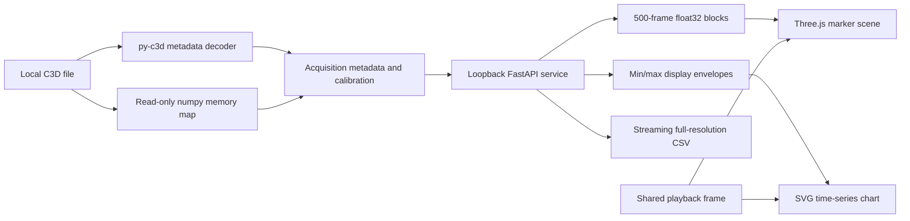

# Architecture and validation

## Data path

The service does not load the entire recording into an in-memory acquisition. A structured NumPy memory map describes interleaved point and analog samples. Bounds use approximately 150 sampled frames; series requests copy only the selected channels. The browser retains a small neighborhood of frame blocks, prefetches the next block, and advances in recording time. Browser rendering can skip intermediate acquisition frames at high sample rates; frame stepping and exports retain the source resolution.

An LRU retains up to three metadata / mapping objects. Frame ranges are zero-based and half-open in the API; the UI converts the original C3D frame numbers at its boundary. Point data is transmitted as little-endian float32, shape `[frames, points, xyz]`, with NaN coordinates for invalid samples. JSON endpoints use `null` for missing values.

Analog series retain sample-level times. A min/max envelope also keeps a missing sample per bin to preserve visible discontinuities. No analysis or CSV export uses that display envelope.

## Preferences and folder export

`PreferencesProvider` owns validated language, theme and panel sizes. The desktop preload exposes restricted preference IPC; `preferences.json` is independent of the directory settings. Native and web themes follow the same choice, and system theme changes are observed. SVG charts use theme tokens, while the WebGL renderer changes its colors without rebuilding the camera.

`POST /api/library/exports` snapshots the registered current-folder files. `GET /api/library/exports/{id}` returns progress; `DELETE` requests cancellation; `GET .../{id}/download` returns a completed ZIP. The single worker bypasses the selected-channel limit and exports all channels and all frames. It stages only one recording at a time, writes CSV and ZIP contents in bounded chunks, and keeps a manifest of successes and failures without absolute source paths. Downloads hold a lease so a new export or expiry cannot delete an in-flight file. Results expire after 30 idle minutes. Filename numbering prevents collisions across case and Unicode normalization differences.

The per-file export API accepts `scope=selected` (the backwards-compatible default), `scope=all` for every point or analog channel, and `scope=com` for recognized source COM and floor projections. The UI explicitly requests all points / all frames by default. COM roles are additive metadata derived from exact normalized label suffixes (`CentreOfMass`, `CenterOfMass`, `COM`, and `Floor` variants), preserving subject prefixes and raw sample values. A missing COM channel is reported; marker averaging is not implemented as a substitute. `create_demo(..., include_com=True)` creates an optional mathematical regression fixture without changing the default 35-marker demo.

## Format adaptations

1. **Numbered parameter arrays.** Vicon can split arrays at 255 entries, including `LABELS2`, `SCALE2`, `OFFSET2` and `UNITS2`. Each family is concatenated before channel indexing. py-c3d 0.6 does not concatenate these analog arrays in its default frame transformation.
2. **Long frame counters.** `TRIAL:ACTUAL_START_FIELD` stores two unsigned 16-bit words. The high word is multiplied by 65,536, correcting py-c3d 0.6's 65,535 multiplier. The patched subclass changes only the metadata accessor; data decoding remains independently testable.
3. **Model outputs.** `POINT:ANGLES`, `FORCES`, `MOMENTS`, `POWERS` and `SCALARS` identify non-positional data. They appear in the model channel tab and retain their declared units rather than entering the 3D marker cloud.
4. **Vicon local coordinate points.** A documented list of common segment-axis labels is hidden by default and can be enabled. Other labels remain untouched. Unknown marker sets display as a point cloud; the app does not invent segments for them.

## Tests

The Python suite checks float and integer coordinate scaling, calibrated analogs, missing samples, extended analog arrays at channel 255, long frame counters, nonzero-start event timing, truncation rejection, binary/JSON agreement, API bounds, CSV sample counts / timestamps, envelope extrema and local-origin protection.

Files removed or changed during a session produce recoverable errors before a cached map is accessed. Reopening a changed file refreshes the acquisition. The development validation can be repeated without copying recordings: `python -m scripts.validate_local /path/to/Vicon` prints aggregate results only.

Browser tests exercise playback and looping, frame stepping, channel selection, analog CSV downloads, event navigation, missing point display, parameter inspection, recoverable folder errors and layout at 1440×900, 1280×720, 768×1024 and 390×844, theme / language persistence, system-theme changes, focus handling, splitter pointer / keyboard interaction and folder ZIP downloads.

### Reproducible synthetic validation — 2026-10-23

The published benchmark uses only the deterministic walking acquisition generated by `backend/demo.py`. Its coordinates and signals are mathematical fixtures, not participant measurements. Generate one acquisition in an empty local folder and pass that folder to `scripts.validate_local` to repeat the checks.

| Check | Result |
| --- | --- |
| Synthetic files inspected | 1 |
| Generated file size | 579,584 bytes |
| Point frames / markers | 800 / 35 |
| Analog channels | 4 |
| Point / analog sample rate | 100 / 1,000 Hz |
| Synthetic gait events | 13 |
| Reference checks | First 3 frames against the upstream py-c3d decoder |
| Independent random access | First, middle and last records via Python `struct` |
| Maximum sampled point difference | 0 |
| Maximum sampled calibrated analog difference | 0 |

This verifies sampled numerical agreement on a reproducible fixture, not performance or clinical validity on real recordings. Separate synthetic regression fixtures cover split analog parameters and long frame counters. Force plate calibration, COP / GRF and clinical interpretation are outside the implemented scope. Earlier Git commits retain the previous validation text; this update does not rewrite history.

## Interface decisions

The workbench uses the Data terminal direction (design seed `196176706`): neutral dark surfaces (with a matching light theme), a blue selection rule, Public Sans text and IBM Plex Mono for frame counters / measurements. The largest region answers “What was the subject doing at this acquisition frame?”; the selected signal and event timeline provide synchronized evidence. No measurements are invented for the UI. Screenshots use the explicitly synthetic walking generator.

The browser design inspection at desktop, tablet and phone widths checks layout, contrast, loaded fonts and overflow. The intentional density leaves many secondary labels at 11–12 px, appropriate to a scientific workstation; all text remains at least 11 px. No shadow is used on resting panels; drawers and dialogs are overlays.

The playback slider's two-color hard-stop fill encodes time progress, an intentional exception to the decorative-gradient rule. Inspector group labels organize acquisition fields; monospace text is reserved for measurements, frame counts, parameter values and channel identifiers. Dashes denote unavailable data. These explain the static linter's remaining warnings.
